# 🚗 AlugaCar: Sistema de Aluguel de Carros

> [!NOTE]
> Sistema web para **efetuar, modificar, cancelar e avaliar pedidos de aluguel de automóveis pela Internet**, do pedido do cliente até a execução do contrato.

<table>
  <tr>
    <td width="800px">
      <div align="justify">
        Clientes criam e acompanham pedidos de aluguel. Agentes, que podem ser empresas ou bancos, analisam esses pedidos do ponto de vista financeiro e, em caso de parecer positivo, executam o contrato, que pode incluir um contrato de crédito. Projeto desenvolvido no <b>Laboratório 02</b> da disciplina de <b>DIAW</b> da PUC Minas.
      </div>
    </td>
    <td>
      <div>
        
      </div>
    </td>
  </tr>
</table>

---

## 🚧 Status do Projeto


---

## 📚 Índice

- [Links Úteis](#-links-úteis)
- [Sobre o Projeto](#-sobre-o-projeto)
- [Funcionalidades Principais](#-funcionalidades-principais)
- [Tecnologias Utilizadas](#-tecnologias-utilizadas)
- [Arquitetura](#-arquitetura)
  - [Diagramas](#diagramas-v2)
- [Instalação e Execução](#-instalação-e-execução)
  - [Pré-requisitos](#pré-requisitos)
  - [Variáveis de Ambiente](#-variáveis-de-ambiente)
    - [1 Back-end (Spring Boot)](#1-back-end-spring-boot)
    - [2 Front-end (React, Vite)](#2-front-end-react-vite)
  - [Instalação de Dependências](#-instalação-de-dependências)
    - [Front-end (React)](#front-end-react)
    - [Back-end (Spring Boot)](#back-end-spring-boot)
  - [Inicialização do Banco de Dados (PostgreSQL)](#-inicialização-do-banco-de-dados-postgresql)
  - [Como Executar a Aplicação](#-como-executar-a-aplicação)
    - [Terminal 1: Back-end (Spring Boot)](#terminal-1-back-end-spring-boot)
    - [Terminal 2: Front-end (React, Vite)](#terminal-2-front-end-react-vite)
  - [Primeiro uso](#-primeiro-uso)
- [Deploy](#-deploy)
- [API](#-api)
- [Estrutura de Pastas](#-estrutura-de-pastas)
- [Demonstração](#-demonstração)
  - [Aplicação Web](#-aplicação-web)
  - [Exemplo de Saída no Terminal](#-exemplo-de-saída-no-terminal)
- [Testes](#-testes)
- [Documentações utilizadas](#-documentações-utilizadas)
- [Autores](#-autores)
- [Contribuição](#-contribuição)
- [Agradecimentos](#-agradecimentos)
- [Licença](#-licença)

---

## 🔗 Links Úteis

- 🌐 **Demo Online:** não há versão publicada. A aplicação é executada localmente, conforme a seção [Como Executar a Aplicação](#-como-executar-a-aplicação).
- 📖 **Histórias de usuário:** [`docs/historias-de-usuario.md`](docs/historias-de-usuario.md)
- 📐 **Modelos UML, versões e modificações:** [`docs/uml/README.md`](docs/uml/README.md)

---

## 📝 Sobre o Projeto

O objetivo é apoiar a gestão de aluguéis de automóveis, levando para a Internet um processo que envolve clientes, empresas e bancos. O sistema centraliza o pedido, a análise financeira e o contrato, e permite que cada participante acompanhe a situação do aluguel.

O uso do sistema exige cadastro prévio e login. Depois de criado, o pedido segue este ciclo:

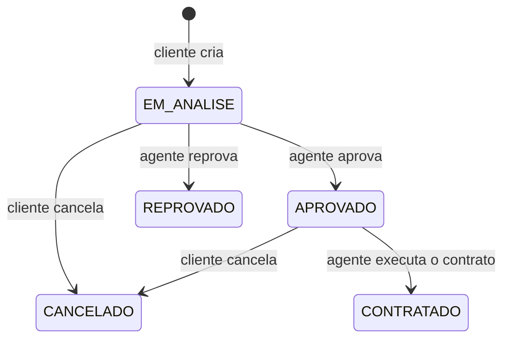

Na execução do contrato, o automóvel pode ser registrado como propriedade do **cliente**, da **empresa** ou do **banco**. O aluguel pode ser associado a um **contrato de crédito** concedido por um dos bancos agentes.

---

## ✨ Funcionalidades Principais

- 🔐 **Autenticação:** cadastro prévio e login com usuário e senha para clientes e agentes.
- 👤 **CRUD de cliente:** identificação (RG, CPF, nome e endereço), profissão e até 3 entidades empregadoras com rendimentos.
- 📝 **Pedidos do cliente:** criar, consultar, modificar e cancelar pedidos, acompanhando o status.
- 📊 **Análise financeira:** agentes consultam a renda do cliente, modificam pedidos e registram um parecer.
- 📄 **Contratos:** execução de pedidos aprovados, com registro do proprietário do automóvel.
- 🏦 **Crédito:** contrato de crédito opcional, concedido por um banco agente.
- 🚘 **Automóveis:** cadastro de matrícula, ano, marca, modelo e placa.
- 🛡️ **Controle de acesso:** cada usuário só acessa as funções e os dados permitidos ao seu perfil.

---

## 🛠 Tecnologias Utilizadas

### 💻 Front-end

- **Biblioteca:** React 19
- **Linguagem:** JavaScript (ES6+)
- **Rotas:** React Router 7
- **Estilização:** CSS
- **Gerenciamento de estado:** Context API
- **Build:** Vite 8

### 🖥️ Back-end

- **Linguagem:** Java (JDK 25)
- **Framework:** Spring Boot 4.0.9
- **Build e dependências:** Apache Maven
- **Banco de dados:** Supabase (PostgreSQL)
- **ORM e migrações:** Spring Data JPA, Hibernate e Flyway
- **Autenticação:** Spring Security, JWT e BCrypt
- **Testes:** JUnit 5, MockMvc e H2

### ⚙️ Infraestrutura & DevOps

- **Banco de dados em nuvem:** Supabase
- **Migrações:** Flyway
- **Containerização, orquestração e CI/CD:** não utilizados neste protótipo

---

## 🏗 Arquitetura

O sistema é uma aplicação cliente-servidor dividida nos dois subsistemas pedidos na especificação:

- **Construção dinâmica das páginas web (`frontend`):** aplicação React que monta as telas a partir dos dados da API.
- **Gestão de pedidos e contratos (`backend`):** API em Spring Boot com a arquitetura MVC e as regras de negócio.

No MVC, o `model` guarda as entidades, os `controller` recebem as requisições e o React atua como a camada de visão. A camada `service` concentra as regras, e `repository` faz o acesso ao banco. Os `dto` separam a API das entidades, o que impede, por exemplo, a exposição do hash da senha.

Os principais padrões adotados são **MVC**, **Service Layer**, **Repository** e **DTO**.

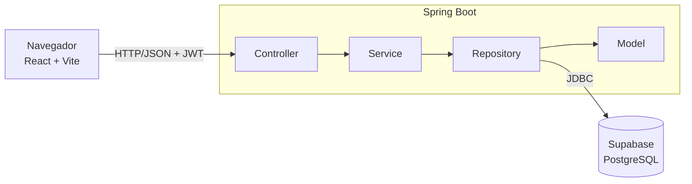

### Decisões importantes

- **Login sem sessão no servidor:** após o login, cada requisição envia um token JWT válido por 8 horas. Contas excluídas perdem o acesso imediatamente, pois o usuário é relido do banco.
- **Conflitos de reserva:** um bloqueio no automóvel impede dois contratos simultâneos no mesmo período, e a coluna `versao` evita que alterações simultâneas em um pedido se sobrescrevam.
- **Banco versionado:** o Flyway cria e atualiza as tabelas, e o Hibernate apenas valida se elas correspondem às entidades.
- **Limitação do protótipo:** o cadastro de agentes é público. Em produção, ele precisaria de uma aprovação.

### Diagramas (v2)

| Casos de uso | Pacotes (visão lógica) |
| :---: | :---: |
| 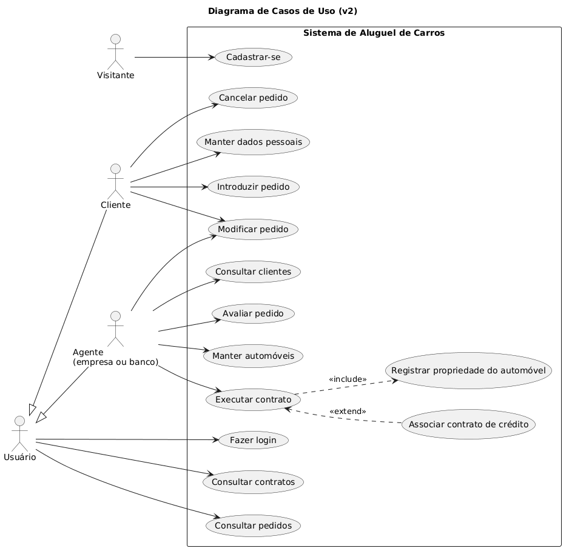 | 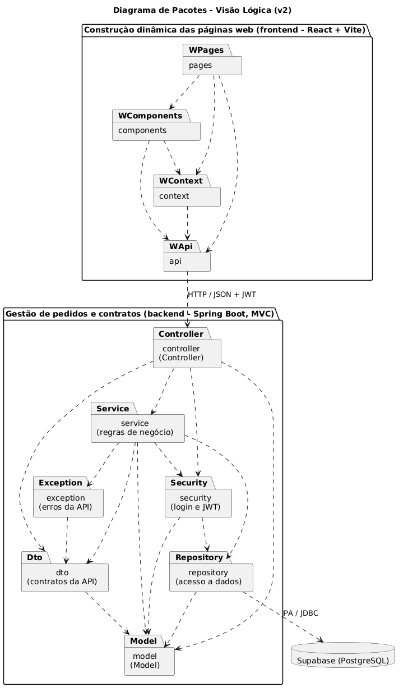 |

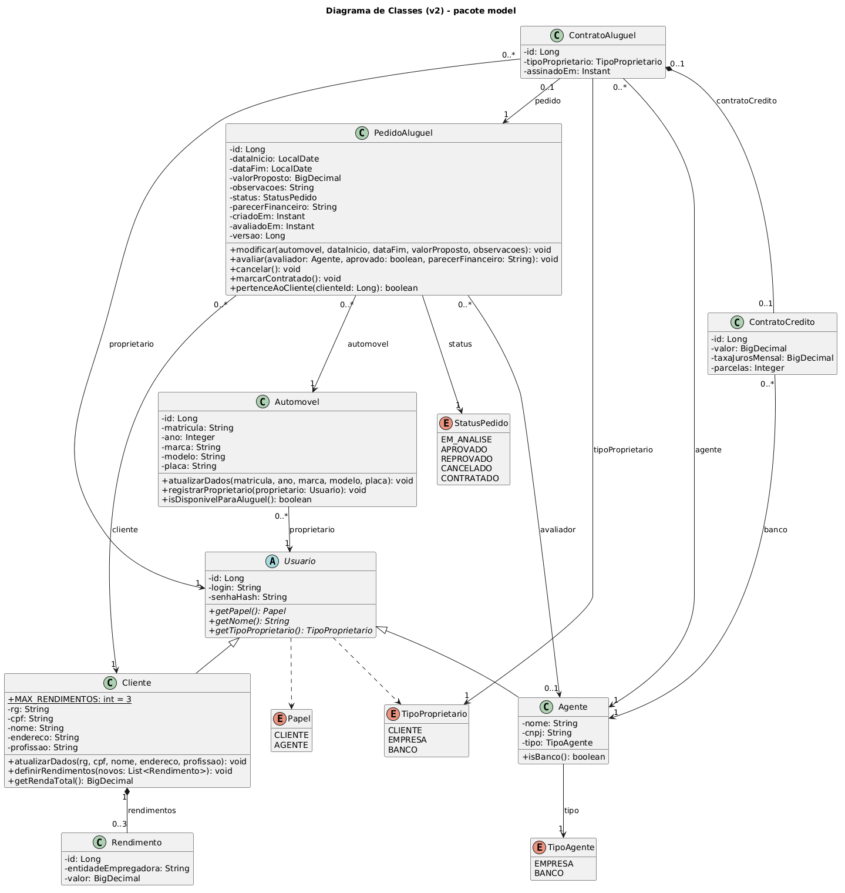

As versões anteriores e a comparação entre os modelos estão em [`docs/uml/README.md`](docs/uml/README.md).

---

## 🔧 Instalação e Execução

### Pré-requisitos

- **Java JDK:** versão 25
- **Node.js:** versão 24 (LTS) e npm
- **Supabase:** um projeto próprio

O Maven não precisa ser instalado, pois o repositório inclui o Maven Wrapper (`./mvnw`). O Docker não é necessário para executar a aplicação.

---

### 🔑 Variáveis de Ambiente

#### 1 Back-end (Spring Boot)

Copie o arquivo de exemplo e preencha os valores:

```bash
cp backend/.env.example backend/.env
```

No Supabase, os dados de conexão ficam em **Connect > Direct > Session pooler > JDBC**.

| Variável | Descrição | Exemplo |
| :--- | :--- | :--- |
| `SPRING_DATASOURCE_URL` | URL JDBC do Session pooler | `jdbc:postgresql://aws-1-sa-east-1.pooler.supabase.com:5432/postgres?sslmode=require` |
| `SPRING_DATASOURCE_USERNAME` | Usuário do banco | `postgres.<PROJECT_REF>` |
| `SPRING_DATASOURCE_PASSWORD` | Senha do banco | `<SENHA>` |
| `JWT_SECRET` | Chave Base64 com pelo menos 32 bytes (`openssl rand -base64 48`) | `<CHAVE>` |
| `SERVER_PORT` | Porta do back-end (opcional) | `8080` |
| `CORS_ORIGENS` | Origens permitidas (opcional) | `http://localhost:5173` |

> [!IMPORTANT]
> O arquivo `backend/.env` contém segredos e é ignorado pelo Git. Nunca faça commit dele.

#### 2 Front-end (React, Vite)

Nenhuma configuração é necessária em desenvolvimento, pois o Vite encaminha `/api` para `http://localhost:8080`. Se o back-end estiver em outro endereço, defina `VITE_API_URL` em `frontend/.env` (veja `frontend/.env.example`).

---

### 📦 Instalação de Dependências

Clone o repositório:

```bash
git clone https://github.com/afplinio/diaw-laboratorio-2.git
cd diaw-laboratorio-2
```

#### Front-end (React)

```bash
cd frontend
npm install
cd ..
```

#### Back-end (Spring Boot)

```bash
cd backend
./mvnw clean install
cd ..
```

---

### 💾 Inicialização do Banco de Dados (PostgreSQL)

O banco é um PostgreSQL gerenciado pelo Supabase, portanto não é preciso criar um container local. Nenhum script manual é necessário: ao iniciar, o back-end aplica as migrações de `backend/src/main/resources/db/migration`.

---

### ⚡ Como Executar a Aplicação

#### Terminal 1: Back-end (Spring Boot)

```bash
cd backend
./mvnw spring-boot:run
```

#### Terminal 2: Front-end (React, Vite)

```bash
cd frontend
npm run dev
```

Acesse **http://localhost:5173**.

> [!NOTE]
> O projeto não usa Docker Compose, pois o banco de dados fica no Supabase.

---

### 🧭 Primeiro uso

1. Cadastre um agente do tipo **Empresa** e cadastre um automóvel.
2. Cadastre um **Cliente** e crie um pedido.
3. Entre como agente, avalie o pedido e execute o contrato.
4. Para testar o crédito, cadastre também um agente do tipo **Banco**.

---

## 🚀 Deploy

A aplicação não está publicada. Os passos abaixo geram e executam os artefatos de produção localmente.

1. **Build do projeto:**

```bash
# Front-end: gera os arquivos estáticos em frontend/dist
cd frontend
VITE_API_URL=http://localhost:8080 npm run build

# Back-end: gera o JAR executável em backend/target
cd ../backend
./mvnw clean package
```

2. **Configuração do ambiente:** defina as variáveis de [`backend/.env`](#1-back-end-spring-boot) no provedor escolhido. Em um domínio real, `VITE_API_URL` deve apontar para o back-end, e `CORS_ORIGENS` deve conter o endereço do front-end.

3. **Execução:**

```bash
# Back-end
cd backend
java -jar target/aluguel-carros-1.0.0.jar

# Front-end, em outro terminal
cd frontend
npm run preview -- --port 5173
```

---

## 🔌 API

Todas as rotas exigem o cabeçalho `Authorization: Bearer <token>`, exceto as marcadas como públicas.

| Método | Rota | Acesso | Descrição |
| :--- | :--- | :--- | :--- |
| POST | `/api/auth/login` | Público | Autentica e devolve o token |
| GET | `/api/auth/me` | Logado | Dados do usuário atual |
| POST | `/api/clientes` | Público | Cadastra um cliente |
| GET | `/api/clientes` | Agente | Lista os clientes |
| GET | `/api/clientes/{id}` | Próprio ou agente | Consulta um cliente |
| PUT | `/api/clientes/{id}` | Próprio | Altera os dados |
| DELETE | `/api/clientes/{id}` | Próprio | Exclui a conta |
| POST | `/api/agentes` | Público | Cadastra um agente |
| GET | `/api/agentes/bancos` | Agente | Lista os bancos |
| GET | `/api/automoveis` | Logado | Lista os automóveis (`?disponiveis=true`) |
| GET | `/api/automoveis/{id}` | Logado | Consulta um automóvel |
| POST | `/api/automoveis` | Agente | Cadastra um automóvel |
| PUT | `/api/automoveis/{id}` | Proprietário | Altera um automóvel |
| DELETE | `/api/automoveis/{id}` | Proprietário | Exclui um automóvel |
| POST | `/api/pedidos` | Cliente | Cria um pedido |
| GET | `/api/pedidos` | Logado | Lista os pedidos (`?status=` para agentes) |
| GET | `/api/pedidos/{id}` | Dono ou agente | Consulta um pedido |
| PUT | `/api/pedidos/{id}` | Dono ou agente | Modifica um pedido |
| POST | `/api/pedidos/{id}/cancelamento` | Dono | Cancela um pedido |
| POST | `/api/pedidos/{id}/avaliacao` | Agente | Registra o parecer financeiro |
| POST | `/api/pedidos/{id}/contrato` | Agente | Executa o contrato |
| GET | `/api/contratos` | Logado | Lista os contratos do usuário |

---

## 📂 Estrutura de Pastas

```
.
├── backend/
│   ├── pom.xml
│   └── src/
│       ├── main/
│       │   ├── java/br/pucminas/diaw/aluguel/
│       │   │   ├── controller/   # Endpoints da API
│       │   │   ├── dto/          # Dados de entrada e saída
│       │   │   ├── exception/    # Respostas de erro
│       │   │   ├── model/        # Entidades do domínio
│       │   │   ├── repository/   # Acesso ao banco
│       │   │   ├── security/     # Login e JWT
│       │   │   └── service/      # Regras de negócio
│       │   └── resources/db/migration/  # Migrações do banco
│       └── test/                 # Testes da API
├── docs/
│   ├── historias-de-usuario.md
│   ├── imagens/                  # Capturas de tela
│   └── uml/                      # Diagramas v1 e v2
└── frontend/
    └── src/
        ├── api/                  # Comunicação com o back-end
        ├── components/           # Componentes reutilizáveis
        ├── context/              # Estado de autenticação
        └── pages/                # Telas do sistema
```

---

## 🎥 Demonstração

### 🌐 Aplicação Web

As telas abaixo usam dados fictícios.

| Login | Cadastro |
| :---: | :---: |
| 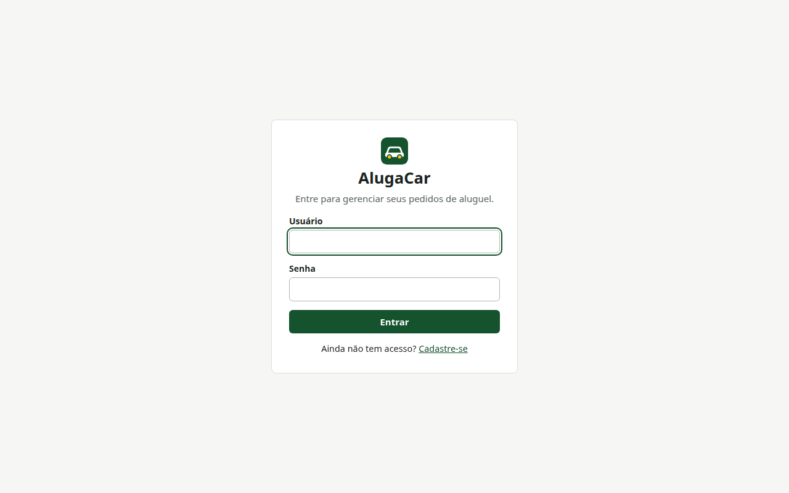 | 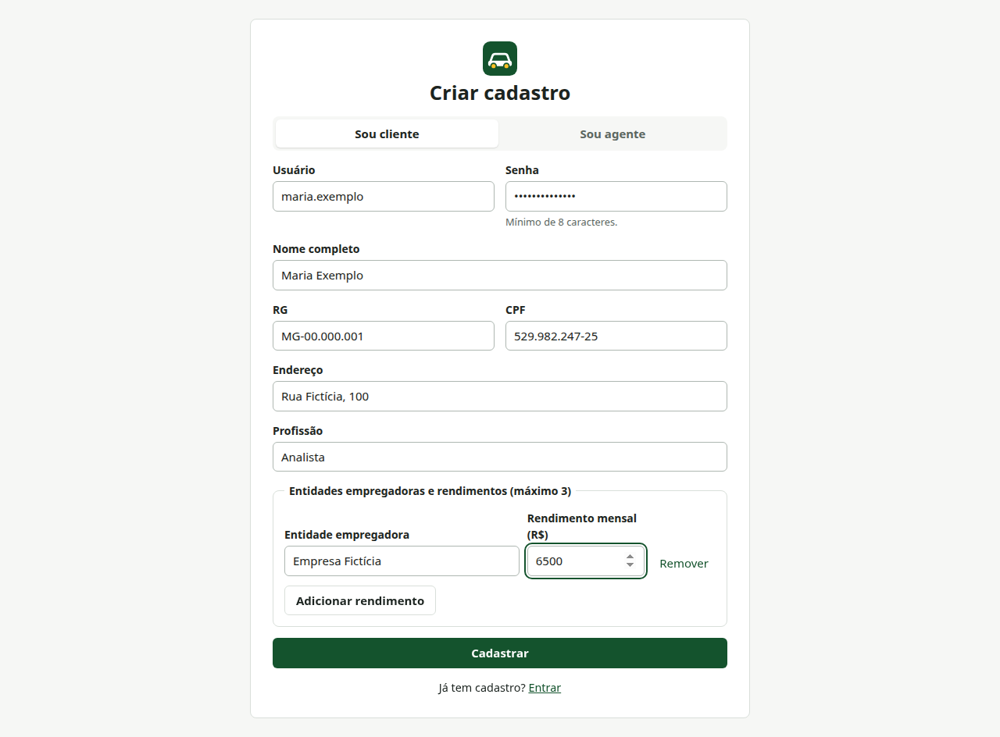 |

| Pedidos do cliente | Análise financeira |
| :---: | :---: |
| 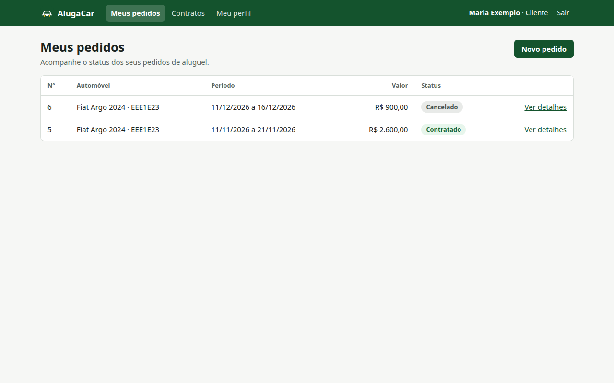 | 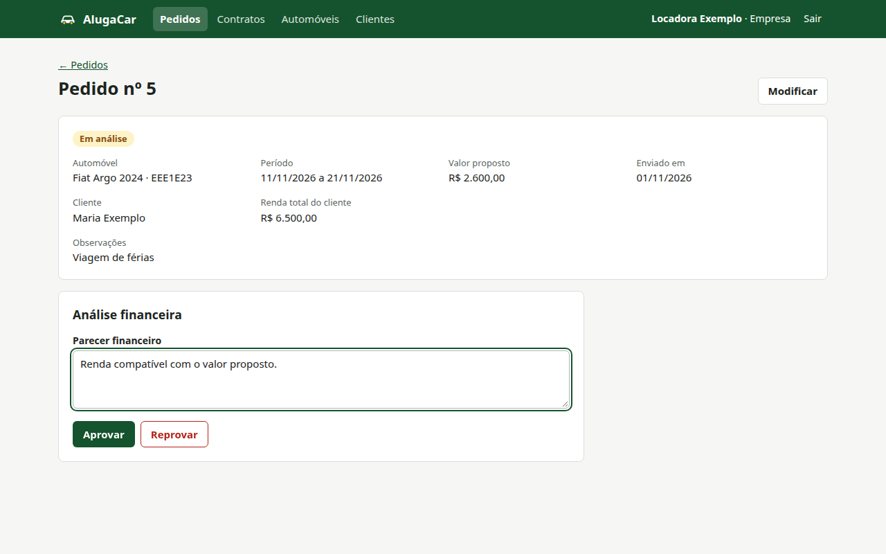 |

| Execução do contrato | Contratos |
| :---: | :---: |
| 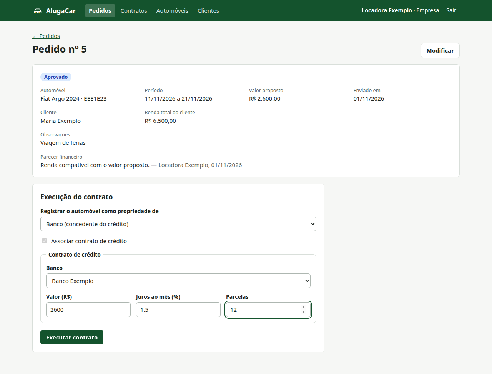 | 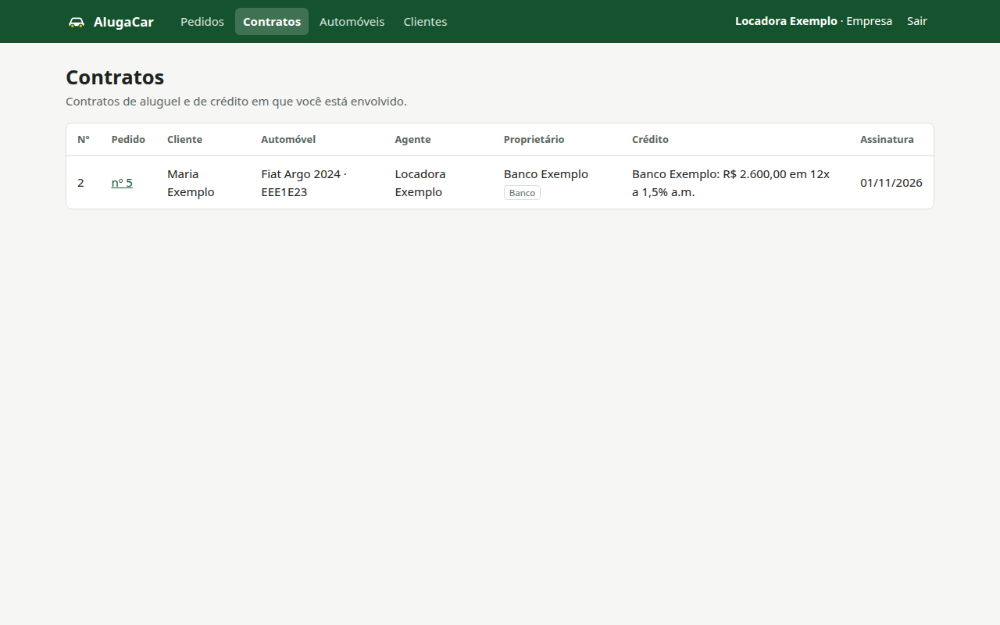 |

| Automóveis | Celular |
| :---: | :---: |
| 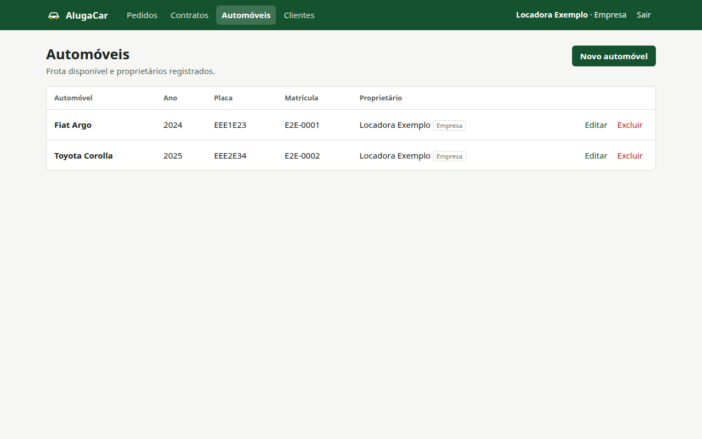 | 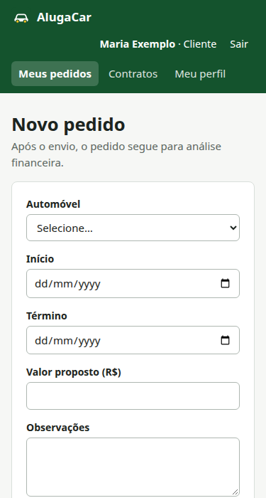 |

---

### 💻 Exemplo de Saída no Terminal

#### 1. Demonstração da API (Exemplo com cURL)

Login de um cliente:

```bash
curl -X POST http://localhost:8080/api/auth/login \
  -H "Content-Type: application/json" \
  -d '{"login":"maria","senha":"senha12345"}'
```

Resposta, com o token abreviado:

```json
{
  "token": "eyJhbGciOiJIUzM4NCJ9...",
  "usuario": {
    "id": 2,
    "login": "maria",
    "nome": "Maria Exemplo",
    "papel": "CLIENTE",
    "tipoAgente": null
  }
}
```

Acesso sem login:

```bash
curl http://localhost:8080/api/pedidos
```

Resposta, com o status HTTP 401:

```json
{"mensagem":"Faça login para continuar","campos":{}}
```

---

## 🧪 Testes

### Testes Unitários e de Integração

Os testes percorrem a API completa, com um banco H2 em memória, e não acessam o Supabase.

```bash
cd backend
./mvnw test
```

São 38 testes de autenticação, permissões, CRUD de cliente, automóveis, pedidos, contratos e crédito.

*Ferramentas utilizadas: JUnit 5, MockMvc e H2.*

### Testes End-to-End (E2E)

O repositório não inclui uma suíte E2E automatizada.

---

## 🔗 Documentações utilizadas

- 📖 **Front-end:** [Documentação oficial do **React**](https://react.dev/)
- 📖 **Build Tool:** [Documentação do **Vite**](https://vite.dev/)
- 📖 **Back-end:** [Documentação oficial do **Spring Boot**](https://docs.spring.io/spring-boot/)
- 📖 **Segurança:** [Documentação do **Spring Security**](https://docs.spring.io/spring-security/reference/)
- 📖 **Banco de dados:** [Documentação do **Supabase**](https://supabase.com/docs)
- 📖 **Migrações:** [Documentação do **Flyway**](https://documentation.red-gate.com/flyway)
- 📖 **Diagramas:** [Documentação do **PlantUML**](https://plantuml.com/)
- 📖 **Guia de estilo:** [**Conventional Commits**](https://www.conventionalcommits.org/pt-br/v1.0.0/)

---

## 👥 Autores

| 👤 Nome | 🖼️ Foto | :octocat: GitHub |
| :--- | :---: | :---: |
| Plínio Ângelo Ferreira |  | [@afplinio](https://github.com/afplinio) |

---

## 🤝 Contribuição

Este é um projeto acadêmico. Para sugerir uma melhoria:

1. Faça um `fork` do projeto.
2. Crie uma branch para sua feature (`git checkout -b feature/minha-feature`).
3. Faça o commit das mudanças (`git commit -m 'feat: adiciona nova funcionalidade'`), usando [Conventional Commits](https://www.conventionalcommits.org/pt-br/v1.0.0/).
4. Faça o `push` para a branch (`git push origin feature/minha-feature`).
5. Abra um **Pull Request (PR)**.

---

## 🙏 Agradecimentos

- [**Engenharia de Software PUC Minas**](https://www.instagram.com/engsoftwarepucminas/): pela estrutura acadêmica e pela proposta do laboratório.
- [**Prof. João Paulo Aramuni**](https://github.com/joaopauloaramuni): pela orientação na disciplina e pelo template deste README.

---

## 📄 Licença

Projeto acadêmico, sem licença de uso definida.
